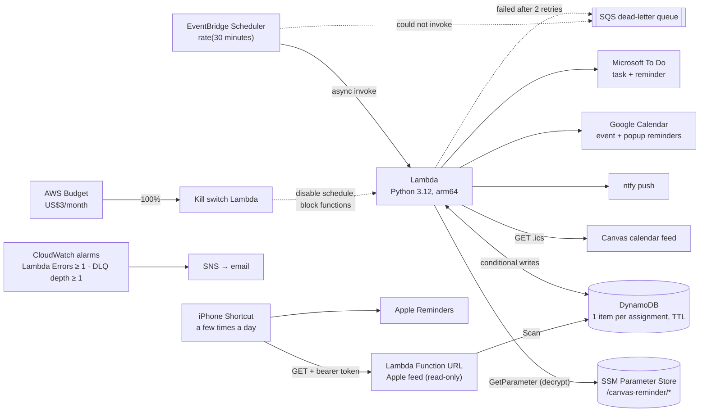
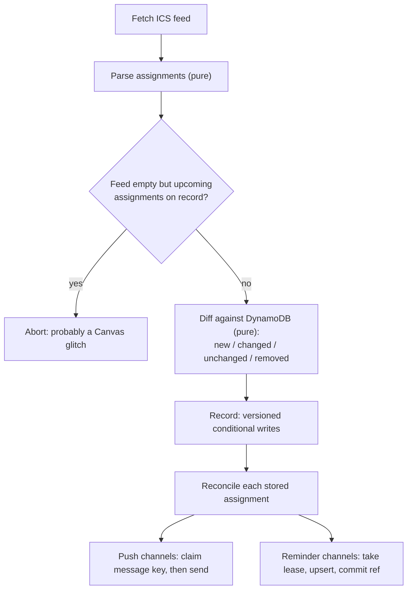
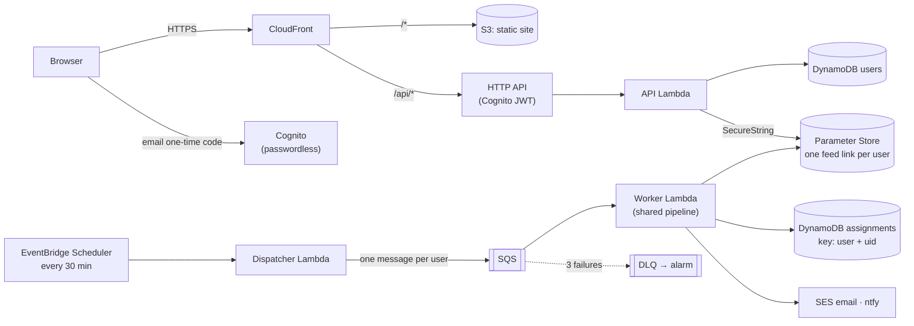

# Canvas Reminder

A small serverless app on AWS that watches my University of Melbourne Canvas calendar and reminds me before assignments are due. It sends reminders by **ntfy** push, **Google Calendar**, **Microsoft To Do** and **Apple Reminders**. You choose how long before each due date you're reminded (`make configure`), and those times apply in every app.

Every 30 minutes it fetches the Canvas calendar feed and works out which assignments are new, changed or removed. It then creates or updates exactly one reminder per assignment in each enabled channel, even if a run is retried or two runs overlap.

```
New: Assignment 1: Systems Report [DEMO10001_2026_SM2]
Due Sat 24 Oct, 11:59 pm AEDT (in 4 days 12 hours)

Due date changed: Assignment 1: Systems Report [DEMO10001_2026_SM2]
Due Tue 27 Oct, 11:59 pm AEDT (in 7 days 11 hours)
Was Sat 24 Oct, 11:59 pm AEDT

Due in 1 hour 59 minutes: Lab 4 Quiz [DEMO20002_2026_SM2]
```

**Stack:** Python 3.12 · AWS SAM · Lambda (arm64) · EventBridge Scheduler · DynamoDB · SSM Parameter Store · SQS · CloudWatch · SNS · GitHub Actions. Region: `ap-southeast-2` (Sydney).

---

## Architecture



### What one run does



| Module | Responsibility | Pure? |
|---|---|---|
| [`ics.py`](src/canvas_reminder/ics.py) | Fetch and parse the feed; UTC/Melbourne conversion | parse: yes |
| [`diff.py`](src/canvas_reminder/diff.py) | Classify new / changed / unchanged / removed | yes |
| [`schedule.py`](src/canvas_reminder/schedule.py), [`messages.py`](src/canvas_reminder/messages.py) | Lead-time maths, notification text | yes |
| [`state.py`](src/canvas_reminder/state.py) | DynamoDB repository: every write is conditional | no |
| [`pipeline.py`](src/canvas_reminder/pipeline.py) | Record, then reconcile; error isolation per channel | no |
| [`notifiers/`](src/canvas_reminder/notifiers/) | `PushNotifier` (ntfy) and `ReminderNotifier` (Google, Microsoft) behind one `Notifier` base | no |
| [`redact.py`](src/canvas_reminder/redact.py), [`http_client.py`](src/canvas_reminder/http_client.py) | Log redaction, retries with backoff, URL-free errors | no |
| [`handler.py`](src/canvas_reminder/handler.py) | Lambda entry point and wiring | no |
| [`apple.py`](src/canvas_reminder/apple.py) | Read-only JSON feed for the Apple Reminders Shortcut | feed builder: yes |

---

## Design decisions

### Why EventBridge Scheduler + Lambda
The job runs for about 2 seconds every 30 minutes, so anything always-on (EC2, a container) would sit idle 99.9% of the time.
- **Scheduler, not a classic EventBridge rule:** Scheduler is AWS's dedicated scheduling service. It has built-in retry policies, its own dead-letter queue, time-zone-aware expressions and 14 million free invocations a month.
- **Lambda:** it gets async retries and a DLQ for free, and the whole workload fits in the always-free tier.
- **Step Functions:** not worth it for one linear task.

### Why DynamoDB
- **Access pattern:** the state is a handful of items keyed by Canvas UID. Each run reads them all and updates a few.
- **Concurrency primitives:** DynamoDB has the ones idempotency needs: conditional writes, atomic `ADD` to a string set, and optimistic locking with a version number.
- **Housekeeping:** TTL cleans up old assignments at no cost, and there are no connections to manage.
- **Cost:** provisioned at 2 RCU/2 WCU, which is inside the always-free 25/25.
- **Alternatives:** RDS would cost money and need a VPC. S3 has no atomic "add to set if absent".

### How idempotency works
The core idea is to **record, then reconcile**.
1. **Record:** each run makes DynamoDB match the feed using versioned conditional writes.
2. **Reconcile:** each stored assignment is then brought up to date in every channel, driven only by what's in DynamoDB.

Because reconciling looks at stored state, not at "what changed this run", a retried run picks up exactly where a failed one stopped. Every side effect is guarded:

| Side effect | Guard | What a retry or a concurrent run sees |
|---|---|---|
| New/changed assignment recorded | `attribute_not_exists(uid)` / `version = :expected` | Condition fails, so it doesn't write again |
| ntfy message (new, changed, removed, due-soon) | **Claim**: `ADD sent :key` with `NOT contains(sent, :key)`, *before* sending | Claim fails, so it doesn't send |
| Google Calendar event | **Lease** per channel, then re-read under the lease, then a **deterministic event id** derived from the UID (PUT) | Lease is taken or already in sync, so it skips. Even a crash after Google accepted the event only re-PUTs the same id |
| Microsoft To Do task | **Lease**, plus a linked resource with `externalId = UID` that is looked up before any create | Finds the existing task and PATCHes it instead of creating another |

Message keys encode exactly what was announced:
- `ntfy:event#v3` is version 3 of the assignment.
- `ntfy:due#2026-10-24T12:59:00+00:00#7200` is the 2-hour reminder for *that* due time.

A title edit doesn't repeat "due in 2 hours", but a due-date change does reset the reminders.

**When a push failure is ambiguous**, for example a timeout after the request was sent, the claim is kept. A rare missed push is better than a duplicate. A definite HTTP error response releases the claim, so the next run retries it.

**No reserved concurrency.** It would stop concurrent runs, but new AWS accounts often have a concurrency quota of 10, which makes reserving any fail to deploy. The conditional writes already make concurrency safe.

### Why ntfy reminders are sent by the scheduler, not ntfy's delayed delivery
ntfy can only delay a message by up to 3 days, and a scheduled message can't be reliably edited when a due date moves. So each run checks whether any lead time has passed. If it has, it sends one push, claimed per lead time. If runs were missed and several lead times have passed, you get **one** push, not a burst. Google Calendar and To Do keep their own reminder clocks, so for those the app only keeps the event or task up to date.

### One set of reminder times, every app
You choose the lead times once with `make configure` (for example 3 days, 1 day and 2 hours), with optional per-course overrides. Every channel uses them:

| Channel | How the times are applied |
|---|---|
| ntfy | One push as each time passes |
| Google Calendar | One popup reminder per time on the event (up to 5) |
| Microsoft To Do, Apple Reminders | These apps allow one alert per item, so the alert is set to the **next** time and moves on as each one passes (3 days → 1 day → 2 hours) |

Each Google event or To Do task stores a fingerprint of the assignment's content **and** its lead times. So if you change the times, or a single-alert reminder needs to move on, the next run updates every existing reminder in place. It never adds a second one.

### Why Apple Reminders goes through an iPhone Shortcut
Apple has no server-side API for Reminders: only apps on your own iPhone or Mac can write to it, and iCloud stopped exposing Reminders over CalDAV with iOS 13. So the direction is reversed:
1. A small read-only Lambda Function URL serves your upcoming assignments as JSON.
2. A Shortcuts automation on your iPhone fetches that feed a few times a day.
3. The Shortcut creates or updates one reminder per assignment, matched by a `canvas-id:` line in the reminder's notes.

The feed function has its own role, which can only **scan** the table and **read** `/canvas-reminder/apple`. It returns 404 unless `apple` is enabled in config and 401 without the bearer token, which it checks in constant time. Shortcuts can't sign AWS (IAM-authenticated) requests, so the token is the authentication.

### Changed and removed assignments
- **Changed** (title, due date or description) updates the existing Google event or To Do task in place. ntfy gets one "Due date changed … Was …" or "Updated" push.
- **Removed** means "no longer in the feed while still upcoming". Canvas drops past events from the feed, and those are just ageing out. What happens is set by `on_removed` in config:
  - `notify` (default): push a notice and keep the reminder.
  - `delete`: also delete the event or task.
  - `ignore`: do nothing.
- **Safety:** if the feed comes back empty while upcoming assignments are on record, the run aborts instead of declaring everything removed.
- **First run:** one summary push ("tracking 7 assignments") rather than seven "New:" pushes.

### Time zones
Canvas exports times in UTC, and all-day due dates as `DATE` values.
- UTC and `TZID` times are converted directly.
- All-day and floating times are treated as **23:59 Melbourne local time on that date**, so the daylight-saving offset is correct for each date. Tests cover both transitions.
- Notifications are shown in Melbourne time with the correct AEST/AEDT abbreviation.
- `tzdata` is bundled so the Lambda image doesn't need system time-zone files.

### Security
- **The Canvas feed URL is a credential.** Anyone with it can read your calendar.
  - It lives only in SSM Parameter Store as an encrypted `SecureString` (or a git-ignored `.env` for local runs).
  - It never appears in config, fixtures or logs.
  - `.gitignore` excludes all `*.ics` except the fake fixtures.
- **Errors never contain URLs.** `requests` puts the full URL in its exception text. Every HTTP call goes through `http_client.request()`, which re-raises naming only the host, with the original exception suppressed.
- **Logs are redacted.** Every secret loaded at runtime is registered and masked verbatim. URL paths, bearer tokens and `*_token` fields are masked as a fallback. The Lambda raises a sanitised `RunFailed` so even the runtime's own crash report is clean. Tests assert none of this leaks.
- **Least-privilege IAM** (hand-written role, not SAM's managed policy):
  - Logs: write to its own log group only.
  - DynamoDB: `GetItem`, `PutItem`, `UpdateItem` and `Scan` on its own table only.
  - Parameter Store: `GetParameter` on `/canvas-reminder/*` only, plus `PutParameter` on `/canvas-reminder/microsoft` only, because Microsoft rotates refresh tokens on every use. Decryption uses the AWS-managed `aws/ssm` key, which needs no extra KMS permission.
  - SQS: send to its own DLQ only.
  - The Apple feed function has a separate role: `Scan` on the table and `GetParameter` on `/canvas-reminder/apple` only. It has no write access to anything.
- **Secret scanning:**
  - `gitleaks` runs as a pre-commit hook and in CI over the full history.
  - There's a custom rule for Canvas feed URLs (`feeds/calendars/user_…`) and ntfy tokens.
- **Deploys** use GitHub OIDC (no stored AWS keys) and a protected environment that needs manual approval.

### Why SSM Parameter Store, not Secrets Manager
Both store encrypted values with IAM-scoped access. Secrets Manager costs US$0.40 per secret per month, which would have been the project's only real cost (about A$2–3.35/month for 3–5 secrets). What it adds over Parameter Store is managed rotation, cross-region replication and resource policies. This project uses none of them: the one secret that rotates, the Microsoft refresh token, is rewritten by our own code.

So every secret is a **Standard-tier `SecureString` parameter**. Those are free to store (up to 10,000 of up to 4 KB each), encrypted with the AWS-managed `aws/ssm` KMS key, and readable at standard throughput for free. The code always passes `Tier="Standard"`, so nothing can silently become a billed Advanced parameter.

### Budget kill switch
An AWS Budget watches the **whole account's** monthly bill. The limit is US$3 by default (`BudgetLimitUsd`).
- **At 80%** it emails you.
- **At 100%** it also publishes to SNS, which triggers the kill switch ([`killswitch.py`](src/canvas_reminder/killswitch.py)). The kill switch:
  1. **disables the schedule**;
  2. sets both functions' **reserved concurrency to 0**, so nothing can invoke them, including the public Apple feed URL.

It also sends a final ntfy push. Secrets stay where they are, because Parameter Store's Standard tier is free. What's left (table, parameters, logs, queue, topics) costs nothing at rest, and **`make resume`** turns everything back on at any time. `make pause` does the same shutdown by hand.

It pauses rather than deleting the stack:
- Deleting the stack would need a function allowed to delete IAM roles, tables and functions. The kill switch's role can only touch this app's schedule and functions.
- A paused stack costs the same as a deleted one, US$0, and keeps your data.

Billing data lags by up to about a day, so spending can pass the limit slightly before the switch fires.

### Known limitations
- Microsoft To Do and Apple Reminders allow **one** alert per item. The alert moves to the next lead time after each one passes, so all your times are used, one at a time.
- Apple Reminders updates only when the Shortcut runs (a few times a day), and the Shortcut is set up by hand on your iPhone; I couldn't test it from here.
- The Apple feed URL is public, protected only by the token. If the token leaks, overwrite the `/canvas-reminder/apple` parameter and update the Shortcut.
- Google Calendar allows at most 5 popup reminders, each at most 4 weeks ahead. Config validation enforces both limits.
- An ntfy topic on the public server is readable by anyone who knows its name. Use a long random name, or a self-hosted server or access token.

---

## Cost

These figures assume the default 30-minute schedule (~1,440 runs a month). AUD prices assume about A$1.50 = US$1 and include 10% GST.

| Service | Usage per month | Cost |
|---|---|---|
| Lambda (arm64, 256 MB) | ~1,440 invocations, ~750 GB-s | Free (always-free 1M requests / 400k GB-s) |
| EventBridge Scheduler | ~1,440 invocations | Free (14M/month) |
| DynamoDB | Provisioned 2 RCU / 2 WCU, < 1 MB | Free (always-free 25/25, 25 GB) |
| SQS, SNS email, CloudWatch (2 alarms, logs with 14-day retention) | Tiny | Free |
| SSM Parameter Store | 3–5 Standard `SecureString` parameters, ~6,000 reads | Free (Standard tier; `aws/ssm` key and its requests within the KMS free tier) |

**Expected total: about A$0/month**, with any number of channels enabled. A **US$3/month budget kill switch** (see Design decisions) pauses everything billable if the bill ever passes that anyway.

---

## Setup

### Prerequisites
- An AWS account and the AWS CLI configured (`aws configure`) for `ap-southeast-2`.
- [AWS SAM CLI](https://docs.aws.amazon.com/serverless-application-model/latest/developerguide/install-sam-cli.html), Python 3.12 and [uv](https://docs.astral.sh/uv/).
- Docker, only if you want `sam local invoke` or LocalStack.

```bash
git clone <this repo> && cd canvas-reminder-pipeline
make setup     # virtualenv, dev dependencies, pre-commit hooks (gitleaks, ruff)
make test
```

### 1. Store your Canvas feed URL
In Canvas, go to **Calendar**, then **Calendar Feed** (bottom right), and copy the URL. **Treat it like a password.**

Store it as an encrypted parameter. Paste it at the hidden prompt so it never lands in your shell history:

```bash
read -rs ICS_URL   # paste, then Enter (nothing is shown)
aws ssm put-parameter --name /canvas-reminder/ics-url --type SecureString --tier Standard \
  --value "$ICS_URL" --overwrite --region ap-southeast-2 && unset ICS_URL
```

This needs AWS CLI v2. The old v1 CLI would download a value that starts with `https://` instead of storing it.

If you ever leak it, reset it in Canvas on the Calendar Feed dialog. That gives you a new URL; run the same command again to replace the stored one.

### 2. ntfy (push notifications)
1. Install the ntfy app ([Android](https://play.google.com/store/apps/details?id=io.heckel.ntfy) / [iOS](https://apps.apple.com/app/ntfy/id1625396347)).
2. Generate a hard-to-guess topic name:
   `python3 -c "import secrets; print('canvas-' + secrets.token_urlsafe(18))"`
3. In the app, subscribe to that topic, then store it:

```bash
read -rs TOPIC && aws ssm put-parameter --name /canvas-reminder/ntfy --type SecureString --tier Standard \
  --value "{\"topic\": \"$TOPIC\"}" --overwrite --region ap-southeast-2 && unset TOPIC
```

(To use an access token on a protected topic, add `"token": "tk_..."` to the JSON.)

### 3. Google Calendar (optional)
1. In the [Google Cloud Console](https://console.cloud.google.com/), create a project and **enable the Google Calendar API**.
2. Set up the **OAuth consent screen**:
   - Choose **External** and add yourself as a test user.
   - Then click **Publish app** to move it to *In production*. Apps left in *Testing* get refresh tokens that **expire after 7 days**.
   - Google won't verify an app for personal use; you'll just see an "unverified app" warning once, which is fine.
3. Under **Credentials**, choose **Create OAuth client ID**, then **Desktop app**, and download the JSON.
4. Authorise. A browser opens, and the refresh token goes straight into `/canvas-reminder/google`:
   ```bash
   .venv/bin/python scripts/google_auth.py --client-secret-file ~/Downloads/client_secret_XXXX.json
   rm ~/Downloads/client_secret_XXXX.json
   ```
5. Add `gcal` to `channels` in [config.yaml](src/canvas_reminder/config.yaml). To use a dedicated calendar instead of your main one, set `google_calendar_id`.

### 4. Microsoft To Do (optional, personal Microsoft account)
1. In the [Azure portal](https://portal.azure.com/), go to **App registrations** and choose **New registration**:
   - **Supported account types:** *Personal Microsoft accounts only*.
   - No redirect URI.
2. Under **Authentication**, set **Allow public client flows** to **Yes**. This is needed for the device code sign-in.
3. Under **API permissions**, add **Microsoft Graph → Delegated → `Tasks.ReadWrite`**.
4. Copy the **Application (client) ID** and authorise:
   ```bash
   .venv/bin/python scripts/ms_auth.py --client-id <client-id>
   ```
   Follow the printed instructions: open the URL, enter the code and sign in. The token goes into `/canvas-reminder/microsoft`. Microsoft rotates the refresh token on each use, and the Lambda writes the new one back.
5. Add `mstodo` to `channels` in config.yaml. Tasks go into a To Do list called `Canvas`, which is created if missing.

University (UniMelb) Microsoft accounts usually block consent for third-party apps, which is why this uses a personal account.

### 5. Choose your reminder times and apps

```bash
make configure
```

The wizard asks a few questions (press Enter to keep the current value):

```
1. When should I remind you?
How long before each due date? Up to 5 times, e.g. 3d, 1d, 2h (d = days, h = hours, m = minutes) [2d, 2h]: 3d, 1d, 2h
  OK: 3 days, 1 day and 2 hours before every due date, in every app you choose.
Should any course use different times? [y/N]: y
  Course code, or its start (e.g. COMP90024); blank to finish: COMP90024
  Times for COMP90024 [3d, 1d, 2h]: 5d, 1d
...
2. Where should reminders go?
  ntfy push notifications? [Y/n]:
  Google Calendar? [y/N]: y
  Microsoft To Do? [y/N]:
  Apple Reminders (via an iPhone Shortcut)? [y/N]: y
```

It then writes [`config.yaml`](src/canvas_reminder/config.yaml) and checks that each chosen app's secret exists in Parameter Store (it can create the Apple token for you). Finally it offers to deploy. After a deploy, existing reminders are updated to the new times on the next run.

You can also edit `config.yaml` by hand:

```yaml
channels: [ntfy, gcal, mstodo]
lead_times: [2d, 2h]            # default: 2 days and 2 hours before
course_overrides:
  COMP90024:                    # prefix of the Canvas course code
    lead_times: [5d, 1d, 2h]
ignore_courses: [UNIB10002]
on_removed: notify              # notify | delete | ignore
```

### 6. Deploy

Put your alarm email in a git-ignored `deploy.env`, then deploy:

```bash
cp deploy.env.example deploy.env   # set ALARM_EMAIL (and FROM_EMAIL for the web app)
make deploy                        # sam build + sam deploy; review the changeset, then y
```

Then:
- **Confirm the SNS subscription email** from AWS, or alarms won't reach you.
- Trigger a run now instead of waiting up to 30 minutes, and watch the logs:
  ```bash
  aws lambda invoke --function-name canvas-reminder-pipeline-reminder --region ap-southeast-2 /dev/stdout
  sam logs --stack-name canvas-reminder-pipeline --tail
  ```
  You should get one push: *"Canvas reminders are on: tracking N assignments"*.

Later deploys: `make deploy` again. Your email lives only in `deploy.env`, never in the repo.

### 7. Apple Reminders (optional, after deploying)
1. Enable `apple` in `make configure` and let it create the `/canvas-reminder/apple` token, then deploy. To see the token again later:
   ```bash
   aws ssm get-parameter --name /canvas-reminder/apple --with-decryption \
     --query Parameter.Value --output text --region ap-southeast-2
   ```
2. Get the feed URL:
   ```bash
   aws cloudformation describe-stacks --stack-name canvas-reminder-pipeline --region ap-southeast-2 \
     --query "Stacks[0].Outputs[?OutputKey=='AppleRemindersFeedUrl'].OutputValue" --output text
   ```
3. In the **Reminders** app, create a list called **Canvas**.
4. In **Shortcuts**, create a shortcut named **Canvas Reminders** with these actions:
   1. **Get Contents of URL**: the feed URL. Under *Show More*: Method `GET`, add a header `Authorization` = `Bearer <your token>`.
   2. **Get Dictionary Value**: get *Value* for key `items` from *Contents of URL*.
   3. **Repeat with Each** item in *Dictionary Value*. Inside the repeat:
      1. **Get Dictionary Value** `tag` from *Repeat Item*. Then **Find Reminders** where *Notes* contains that value and *List* is *Canvas*, limit 1.
      2. **Get Dictionary Value** `action` from *Repeat Item*, then **If** it *is* `delete`: **Remove Reminders** (the found reminder).
      3. **Otherwise**, **If** the found reminders *has any value*: use the **Edit Reminder** action to set its *Due Date* to `due` and its *Alert* to `alert`. Older iOS versions call this action "Set … of Reminder".
      4. **Otherwise** (nothing found): **Add New Reminder** with Title = `title`, List = *Canvas*, Due Date = `due`, Alert = `alert`, Notes = `notes`.

      Get each value with **Get Dictionary Value** from *Repeat Item*, and turn `due` and `alert` into dates with **Get Dates from Input** (they're ISO 8601 times).
   4. **End If / End Repeat**.
5. Under **Automation**, tap **+**, then **Time of Day**. Choose 8:00 am, Daily, and **Run Immediately**, and set it to run *Canvas Reminders*. Add a second and third automation (e.g. 1 pm and 6 pm) so the alerts move on promptly.

Each item in the feed looks like this:
```json
{"id": "event-assignment-100001", "tag": "canvas-id: event-assignment-100001",
 "title": "Assignment 1: Systems Report [DEMO10001_2026_SM2]",
 "due": "2026-10-24T23:59:00+11:00", "alert": "2026-10-22T23:59:00+11:00",
 "alert_text": "Thu 22 Oct, 11:59 pm AEDT", "notes": "https://…\ncanvas-id: event-assignment-100001",
 "action": "add-or-update"}
```

---

## Running locally

| Command | What it does |
|---|---|
| `make configure` | Interactive setup: reminder times, per-course times, which apps; writes `config.yaml` |
| `make demo` | **Local web demo** at http://127.0.0.1:8000: the real pipeline on the fake feed, with ntfy, Google Calendar, To Do, Apple Reminders and the DynamoDB table side by side. Buttons advance the clock, edit the feed and change the reminder times. Nothing is sent |
| `make test` | 100+ unit and integration tests with coverage (moto for DynamoDB and Parameter Store, `responses` for HTTP) |
| `make local` | **Dry run** on the fake sample feed: run 1 sends a summary, run 2 sends nothing, run 3 (due date changed) sends one "Due date changed". In-memory DynamoDB, nothing really sent |
| `make localstack && make local-real` | Real run: secrets from `.env` (copy `.env.example`), state in LocalStack, real notifications |
| `make invoke` | `sam local invoke` in the Lambda container (Docker). Copy `env.local.example.json` to `env.local.json` (git-ignored) first |
| `make pause` / `make resume` | Stop everything billable (what the budget kill switch does), and undo it |
| `make check` | Everything CI runs: ruff, mypy `--strict`, tests, `sam validate --lint` |

For local runs, parameter `/canvas-reminder/<name>` is read from env var `CANVAS_REMINDER_<NAME>`, for example `CANVAS_REMINDER_ICS_URL`.

---

## CI/CD

- **[CI](.github/workflows/ci.yml)** runs on every push and PR:
  - gitleaks over the full history
  - ruff lint and format check
  - mypy `--strict`
  - pytest with coverage (fails under 90%)
  - `sam validate --lint`
  - `sam build`
- **[Deploy](.github/workflows/deploy.yml)** is manual only (`workflow_dispatch`). It runs in the `production` environment, so set **Required reviewers** on it and every deploy waits for your approval.
  - It authenticates to AWS with **GitHub OIDC**; there are no access keys in GitHub.
  - Create an IAM role trusted by `token.actions.githubusercontent.com` for this repo, with permission to deploy the stack (CloudFormation, plus the services in `template.yaml`, IAM role creation and the SAM artifacts bucket).
  - Then set the repo secret `AWS_DEPLOY_ROLE_ARN` and the repo variable `ALARM_EMAIL`.

---

## Multi-user web app (`web/`)

The same reminder engine also runs as a **hosted website** that any student can use: sign in with an emailed one-time code, paste a Canvas link, pick channels and times, done. It's a separate stack (`canvas-reminder-web`), so the personal deployment above is unaffected.



- **Isolation:** every assignment row is keyed by `(user, uid)` and every read is a `Query` on that user, so one user's pipeline cannot see another's. The user id comes only from the verified Cognito token, never from a request body.
- **Students' Canvas links are credentials.** Each is stored in its own Standard-tier `SecureString` parameter (free, encrypted with `aws/ssm`), not in the database. The API can only write and delete them; only the worker can read them.
- **Fan-out:** a dispatcher queues one SQS message per active user, and workers (at most 5 at once) run the same tested pipeline. A dead link is shown on that user's dashboard instead of failing the batch; unexpected errors retry 3 times, then alarm.
- **Channels:** email (SES), phone (a private ntfy topic per user), Apple Reminders (a per-user hashed token for the Shortcut feed), plus an optional daily or weekly summary.
- **Website:** plain HTML/CSS/JS with no build step, served from a private S3 bucket through CloudFront, with a strict Content-Security-Policy, HSTS and `/api` on the same origin.

| Command | What it does |
|---|---|
| `make web-dev` | The website on http://127.0.0.1:8100 against the real API code with in-memory AWS mocks. Sign-in code `123456`; paste a real Canvas link or any link containing "example". Nothing is sent |
| `make web-deploy` | Build, deploy the stack and publish the site (needs `deploy.env`) |
| `make web-publish` | Re-upload the site only |

**Before opening it to other people:** request **SES production access** (new accounts can only email verified addresses), consider a domain for the sender address, and note Cognito's built-in email sender allows about 50 sign-in codes a day.

Expected cost: about A$0/month at student scale (everything stays in the free tiers).

---

## Project layout

```
template.yaml            Personal stack (SAM): Lambda, Scheduler, DynamoDB, DLQ, budget kill switch
web/template.yaml        Web app stack: Cognito, HTTP API, workers, S3 + CloudFront
web/site/                The website (HTML, CSS, JS; no build step)
src/canvas_reminder/     Shared engine: ics, diff, pipeline, notifiers, state
src/canvas_reminder/web/ Multi-user layer: users, feed links, API, dispatcher/worker
tests/                   pytest (160 tests); fixtures/ holds a FAKE, anonymised Canvas feed
scripts/                 configure, local runs, OAuth helpers, web dev server, publishing
samconfig.toml           Deploy defaults (no secrets or personal details)
deploy.env.example       Copy to deploy.env (git-ignored) for your email addresses
.github/workflows/       ci.yml, deploy.yml
```
